# Sets: the library of set pieces (`lib/sets/`)

Owner, 2026-11-10: "maybe reusable parts of sets or things / we can create a library of models basically we can use",
after "the sets are all so small, and in a superflat, so when we watch it looks really bad and low effort" and "our
builds are not particularly good looking or creative". This is that library: full-scale pieces that land on natural
terrain in one command, return the spots a story stages on (door, bed, window, stalls...), and come with dressing
helpers for the lived-in layer. Build rules they follow: `docs/building_guide.md` (branch agent/building-guide).

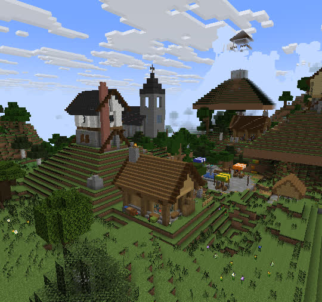

## Use it
```js
const sets = require('../lib/sets')
// in setup (the bot is op, creative, near the site):
const site = await sets.findSite(ctx, { w: 30, d: 30 })                 // flat-enough dry land, trees round it
const home = await sets.place(ctx, 'cottage', { x: site.x, z: site.z, facing: 'east', variant: { palette: 'spruce' } })
home.anchors.door        // { x, y, z, yaw, face, block }: block centre at feet height, yaw looking out of the door
home.anchors.bed         // the bed's head block
home.at(3, 1, 4)         // any piece-local point in world coordinates
home.shots.wide          // { pos, look }: the establishing camera (also .front, .low)
home.box                 // { x0, x1, z0, z1, y0, y1 } world bounds
await sets.dress.path(ctx, [[home.anchors.street.x, home.anchors.street.z], [x2, z2]], { w: 3 })
await sets.vanilla(ctx, 'village_plains', { x, z })                     // a whole vanilla village to build onto
// in perform (stills, establishing shots): the clearest version of a shot, and a cut to it
await sets.shoot(ctx, sets.frame(ctx, home, 'wide'), 10, 'establish')
```
Mobs for the cast: summon them at anchors (`K.vil` / `mob` from lib/story.js take set-relative offsets, or use the
anchor's absolute x, y, z with `/summon` as stunts/_sets_demo.js does).

### What `place` does
1. Builds the piece's voxels in code (`lib/sets/pieces/*.js`), every block state checked against minecraft-data
   (a typo fails at build time, not as a missing block on screen).
2. Writes them as a vanilla structure template (`.nbt`) into the server's `world/generated/hellobuh/structures/`
   (the id carries a content hash: the server caches lookups, misses too).
3. `fit` (default; `lib/sets/terrain.js`, round 2): the land round the piece is reworked the way a builder would,
   from the natural heights read first. Uphill, the hill is cut back and held by a retaining wall of weathered stone
   (stone/mossy/cracked bricks, cobble) where the cut is 3+ high, and the ground rises back to the natural slope
   behind it. Downhill, a stone foundation shows under the building, a retaining wall holds the lot where the drop is
   3+, and small drops become an earth bank. Where a way in (doorstep, street, gate, entrance...) crosses a wall, a
   3-wide flight of stone-brick stairs with cheeks goes down (or up) to the natural ground. Every edge is irregular
   (value noise on the blend distance) and the reworked ground is mixed (grass, coarse dirt, rooted dirt, moss, the
   odd stone) and planted. Water is left as it is. No concentric 1-block rings: round 1's terraces read as pyramids.
4. One `/place template hellobuh:<id> x y z <rotation>`: the game rotates every block state and recomputes fence,
   pane, wall and stair shapes as it lands. Cells a piece doesn't write keep the terrain (gardens sit in real grass).
5. Live extras (a minecart in the mine) are summoned; dropped items killed.

`y` defaults to a low percentile of the ground over the footprint (the piece sinks a little into a slope rather than
standing up on a pad). The ground is natural terrain blocks only (`site.js` GROUND): round 1 skipped a list of
plants instead, read a bee nest in a canopy as the ground, and a watchtower stood on air 20 blocks over a hill.

Choosing ground:
- **Stories live in the shared world** (docs/world/canon.md; owner, 2026-11-10: "wouldnt the lore be crazy if all of
  the sets were the same world"): a story's places have canonical coordinates in `docs/world/map.json`, built by
  `world.build(ctx, { story })` (lib/world.js) with `place()` at fixed x, y, z. After `world.build`, `planSite`,
  `findSite` and `findShore` throw (a search lands somewhere else when anything changes); use them only to scout a
  new place before claiming it (`node scripts/world.js claim`), or with `{ free: true }` for a set outside the canon.
- `sets.planSite(ctx, [{ name, dx, dz, facing, variant }...], { reach, stride })`: the best centre for a whole
  layout, scored on the height range under every footprint (squared), water and snow under them, trees, and the
  height differences between pieces. Use it for any set of more than one piece.
- `sets.findSite(ctx, { w, d, maxRange, minRange, near, avoid })`: one footprint (`minRange` asks for a slope, to
  show off the fit). `sets.findShore(ctx)`: a bank with open water straight out (for the dock).
- `sets.dress.clearTrees(ctx, box)`: a village's clearing (then plant groves back round it).

## The pieces
Sizes are x by y by z of the template (the front faces +z = south at `facing: 'south'`). Every piece also returns
`shots.wide / front / low`. Stills: `docs/sets/<piece>.jpg`, rendered from real recordings on natural terrain
(`stunts/_sets_catalog.js`), except `room`, `tavern` and `windmill` (offline previews, `scripts/set_preview.js`).

| piece | size | what | anchors | variants |
|---|---|---|---|---|
| `cottage` | 15x14x16 | one-room cottage: log posts on the outer line with plank panels set back between them (recessed windows, slab sills, trapdoor heads), stone plinth, spruce roof with overhang, eave brackets and a contrasting verge, stone chimney with smoke, shutters and flower shelves, lit furnished room, fenced garden with gate lanterns, flower beds, vegetable patch, woodpile, plants against the walls | door, doorstep, gate, street, bed, table, seat_w, seat_e, hearth, window_in, window_out, inside (+look), chimney, garden | `palette` oak/spruce/birch/plaster/stone, `garden`, `bed` colour, `trim` wood, `seed` |
| `house2` | 15x17x13 | two-storey town house: stone ground floor with pilasters, timber-framed plaster upper floor jettied over the street on brackets, slate roof with dark verge, brick chimney, lanterns under the jetty, kitchen, stairs, two bedrooms | door, doorstep, street, stairs_bottom, stairs_top, bed, upper_window, table, kitchen, inside, chimney | `palette` (plaster default), `bed`, `bed2` |
| `farmhouse` | 36x15x31 | framed farmhouse with porch, barn with open doors and hayloft, four fenced plots (wheat, carrots, potatoes, beetroot) on water channels, scarecrow, haystacks, pumpkin cart, paddock | door, porch, doorstep, field_gate, field, scarecrow, scarecrow_view, barn_door, barn_inside, hayloft, paddock, yard | `palette` (spruce default), `crops` [4] |
| `well` | 9x13x9 | stone-brick well three deep in water, posts and roof, bucket lantern on a chain, irregular paving, trough | rim, water, center, side | `palette` |
| `camp` | 19x7x19 | campfire in a stone ring, log seats, two ridge tents with bedrolls and lanterns, supplies, firewood, lamp poles, a flag | fire, seat_n/s/w/e, tent_a, tent_b, edge | `tents` 1-2 |
| `graveyard` | 19x9x18 | mossy walls with posts, soul-lantern gate, rows of mixed headstones (signed names, candles, flowers), a crypt with a glowing sign, dead tree, cobwebs | gate, outside, center, crypt, tree, grave_0..n (in front of each stone) | `names` ['L1\|L2', ...] |
| `market` | 27x10x27 | round square of mixed paving, fountain, four striped stalls (produce, fish, smith, flowers, books), benches, lamp posts, trees in planters | center, fountain, entrance, bench_w, bench_e, stall_0..3 (seller), buyer_0..3 | `goods` [4] |
| `church` | 13x31x28 | buttressed stone nave, stained glass, slate roof, pews, red aisle, altar with candles, lectern, chandeliers, bell tower with open belfry, bell and spire | door, doorstep, altar, pulpit, aisle, pew, bell, belfry | `glass` colour |
| `watchtower` | 9x24x10 | stone base room, log legs with beams, ladder through hatches, railed lookout, bell, pyramid roof, banners | door, doorstep, ladder, top, lookout, bell, base | `height`, `palette` |
| `lighthouse` | 15x35x15 | round striped tower on a rocky base, door with lamps, ladder spine, railed gallery, glass lantern room with a sea lantern, copper roof | door, doorstep, approach, gallery, gallery_side, light, inside | `height`, `stripe`, `white` |
| `bridge` | 9x18x25 | stone bridge: plank deck, low walls, piers with cutwaters and arches going down `drop` blocks, lamp posts, banners | end_a, end_b, middle, rail, approach_b | `length`, `width`, `drop` |
| `mine` | 21x13x22 | its own rocky hill with a timber portal, framed tunnel with rails, lanterns, ore, cobwebs, spoil heaps, a minecart, a KEEP OUT sign | mouth, portal, inside, deep (looking back at the light), cart, hilltop | `depth` |
| `basement` | 13x7x11 | stone cellar under the ground (y -6..-1): hatch and ladder, beams and posts, barrels, chests, bookshelves, bed, cobwebs, dim lanterns | hatch, ladder_bottom, center, corner (+look), bed, portal | `eyes` 0-12: an end portal frame with that many eyes (story: "One More Eye"), `hatch` |
| `tavern` | 26x17x20 | L plan: a two-storey hall (framed stone ground floor, jettied timber-and-plaster upper floor, steep slate roof with spruce verges, brick chimney with smoke) and a one-storey wing with a cross gable; double doors, hanging signboard, bar with barrels and stools, hearth, tables, rooms upstairs, kitchen in the wing, a fenced beer garden | door, doorstep, street, bar (barkeep), bar_front (customer), table, hearth, inside (+look), wing_door, kitchen, garden, upstairs | `palette` (plaster default), `name` 'THE\|CRAFTY\|CREEPER', `seed` |
| `windmill` | 25x29x15 | tapering stone tower (darker, mossy at the foot), timber cap with a roof, four canvas sails on an axle, millstone and sacks inside, a granary shed with a lean-to roof, a cart | door, doorstep, approach, inside, cap, granary, sails | `height` |
| `dock` | 13x15x22 | a timber dock: stone landing, plank walk on log piles down into the water with a rail, a T-head with a fishing shack, cargo, a bell, lamps. Place it with `findShore` (facing out over the water, `y` the bank) | shore, walk, end, shack, moor, approach | `length`, `depth` |
| `station` | 15x6x25 | a rail station at the end of a line: buffer stop (wall + lantern) and a powered activator rail with its redstone torch, slab platform on the west with a north apron, lamp posts, a bench, a destination sign, crates; two sidings branching east, each with its own buffer and name sign (a minecart on siding A). Facing = the way the line leaves | buffer, mark, activator, line_end, siding_a, siding_b, bench, sign | `length`, `sign` ("A\|B"), `a`, `b` (siding names), `cart` |
| `room` | 15x13x13 | a furnished living-room set with a ceiling for interior scenes: fireplace, armchairs, rug, dining table, bed nook, kitchen corner, bookshelves, windows, lanterns on beams | door, doorstep, fire, armchair_l, armchair_r, table, bed, kitchen, wide (+look), reverse (+look) | `palette` |

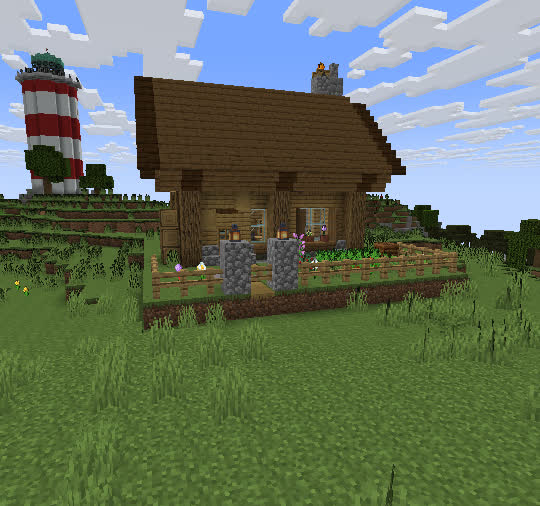 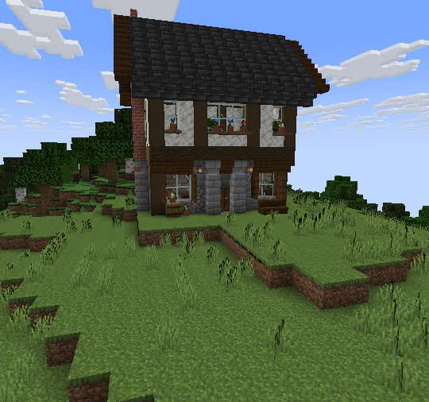 
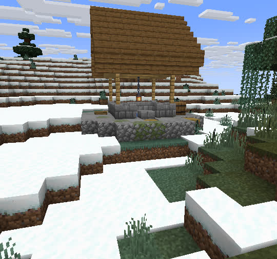 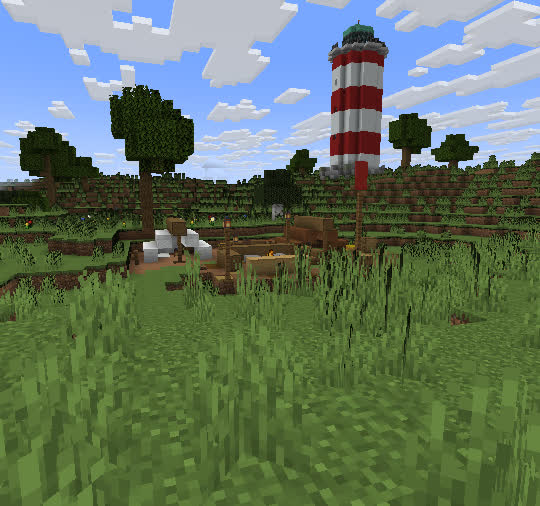 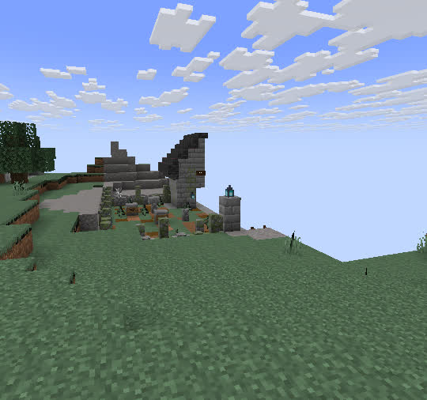
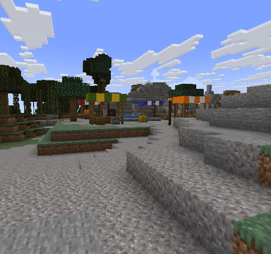 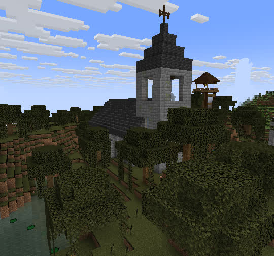 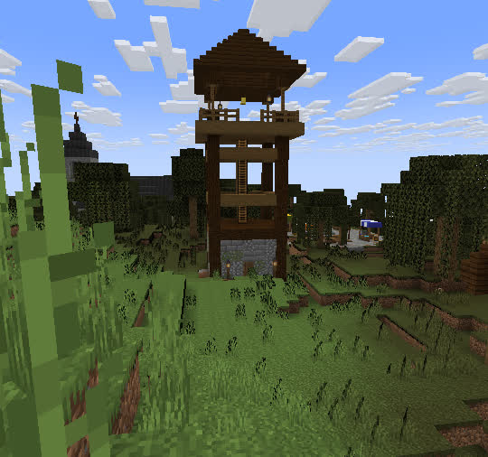
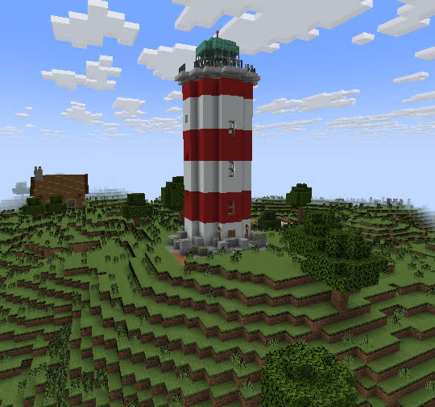 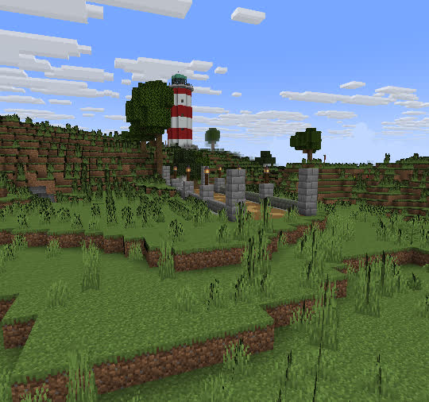 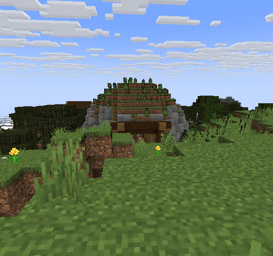
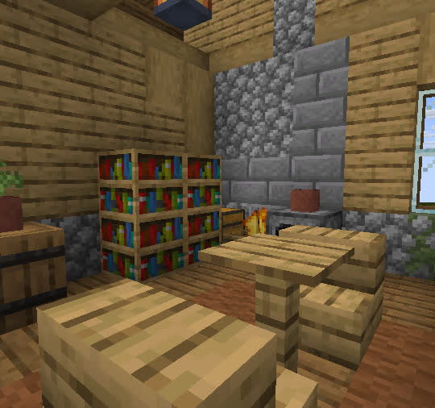 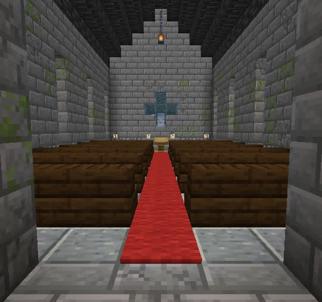 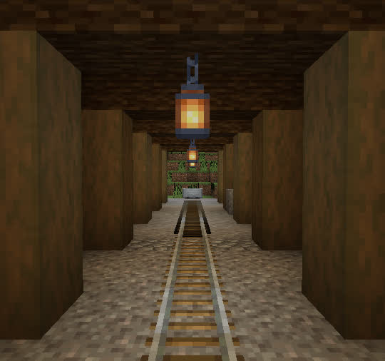
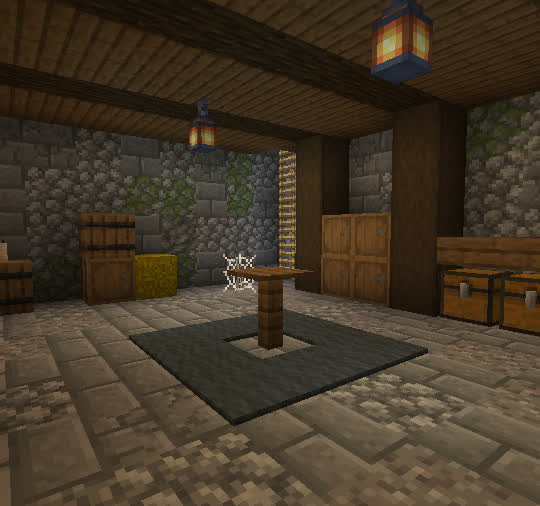 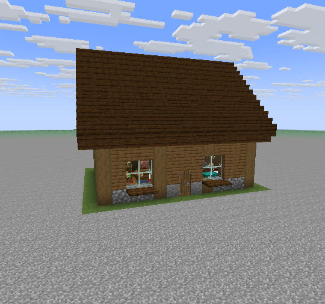
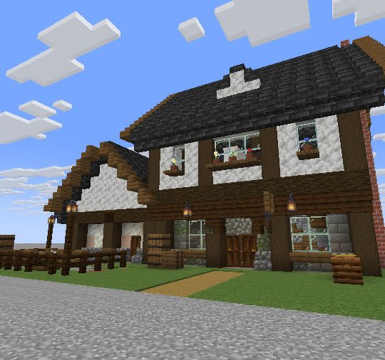 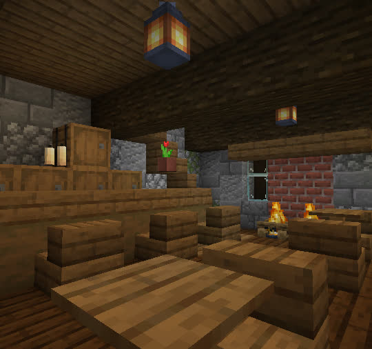 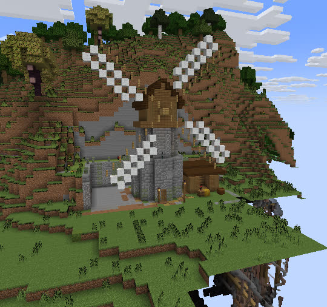 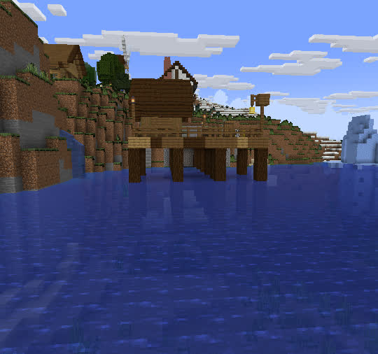

The fit on steep ground (offline previews over recorded terrain): 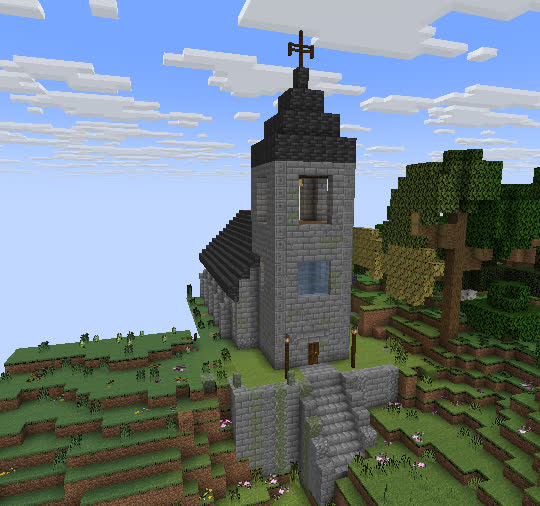 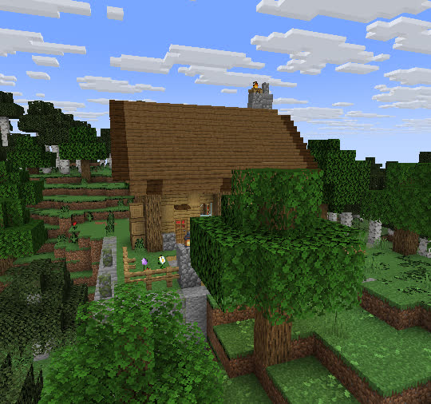

### Vanilla structures (`sets.vanilla(ctx, id, { x, z, mobs, scan })`)
`/place structure` with the chunks force-loaded first; returns `anchors.bell`, `beds[]`, `doors[]`, `work[]` (job
blocks) from a fresh scan. `mobs`: 'freeze' (default: villagers, golems and cats get NoAI and stay where they stood,
for continuity across cuts), 'kill', 'keep'. Ids in `sets.VANILLA`: village_plains/taiga/savanna/desert/snowy,
pillager_outpost, ruined_portal (+ _mountain, _swamp...), igloo, swamp_hut, desert_pyramid, jungle_pyramid,
trail_ruins, shipwreck_beached, mansion. A village is random and wide (~80 blocks from its start): place it once
for a story, then build onto it (a cottage at its edge, the market in its square, lamps along its paths). Its own
.nbt files are Mojang's: never extract them into the repo; refer to them by id.

### Dressing (`sets.dress`)
All of it lands on the real ground (`execute positioned over motion_blocking_no_leaves`), so it is right on slopes
and next to other builds.

| helper | what |
|---|---|
| `flowers(ctx, { x, z, r, n, kinds, clump })` | flowers on grass, in clumps |
| `grass(ctx, { x, z, r, n, tall })` | short grass, ferns, bushes, some tall grass |
| `path(ctx, [[x, z], ...], { w, blocks, edge })` | a worn path along a polyline: dirt path, frayed coarse dirt and gravel edges, plants cleared |
| `lamp(ctx, x, z, { h, fence, lantern, style: 'post'\|'hang' })` | a lantern on a post (or hanging from an arm) |
| `rails(ctx, [[x, z], ...], { y0, y1, fixed_range, skipz, boost, side, smooth })` | a rail line on the real terrain along axis-aligned legs (curves at the corners): the bed smoothed to at most 1 block per block (ascending rails), embankments and cuttings 3 wide, ballast; `boost: 8` a powered rail and a redstone torch every 8. Also a map.json stamp: `{ do: 'rails', pts, opts }` |
| `tree(ctx, x, z, kind)`, `grove(ctx, { x, z, r, n, kinds, minR })` | vanilla trees (`/place feature`: oak, fancy_oak, birch, spruce, dark_oak, cherry, azalea_tree...) |
| `rocks(ctx, x, z, { r })` | a mossy boulder with ferns |
| `clutter(ctx, x, z, kind)` | crates, logs, pots, cart (chest minecart), well, market |
| `crops(ctx, box, crop)` | farmland on the terrain with a water row every 8, ripe crops |
| `fence(ctx, [[x, z], ...])` | a fence along the ground |
| `sign`, `banner`, `frame` (item frame), `light` | at exact spots (signs and banners render; item frames render with their item) |

## Staging tips
- **Depth:** every piece is built to be shot from its front three-quarter (`shots.wide`) with something between the
  camera and it: the garden fence and gate lanterns (cottage), the stall roofs (market), the field rows (farm). Put
  the camera 2-6 blocks behind a foreground object; `dress.grass`/`flowers` at the camera's feet are free depth.
- **Background:** a piece on its own still sits in an empty field. Add a `grove` of big trees (fancy_oak, dark_oak)
  20-40 blocks behind it, a second piece or a vanilla village in the distance, and choose sites with
  `findSite` (it prefers relief and trees in the ring round the footprint).
- **Interiors:** cottage `inside`, room `wide`/`reverse`, basement `corner`, church `aisle`, mine `deep` are framed
  interior views (anchor `look` points). Rooms have ceilings 3-4 high and 2-3 warm lights at different heights.
- **Lines of sight:** `sets.frame(ctx, set, 'wide')` swings, pulls back and raises a shot until nothing (leaves,
  hills) blocks the line to the subject; `sets.shoot` keeps a camera out of the ground without pushing an interior
  camera onto the roof.
- **Dusk:** lanterns, hearths and windows are real light sources; the same set at `time 12900` is a second look
  (`docs/sets/demo/dusk.jpg`).
- **Continuity:** pieces are deterministic for a `seed` (same flowers, same headstones); keep the seed when a story
  needs the same set again. Freeze vanilla mobs (`mobs: 'freeze'`).
- **Known limits:** `fit` banks up at most 5 blocks: a piece on a steep hill gets a stepped mound (pick flatter
  ground). Decorated pots and lectern books don't render. Big pieces (farmhouse, market) need 40x35 of ground.

## Demo: a village from the library (`stunts/_sets_demo.js`)
Round 2 (2026-11-10): `planSite` picks the centre for the whole layout, the trees inside it are cleared, and every
piece is placed where the plan puts it (nudged at most 4 blocks). Market square in the middle, the church behind it
with the graveyard beside it, the tavern (west) and a cottage (east) facing the square, two town houses, a well, the
farm, the windmill, paths from every door, lamps, groves planted back round the edge, boulders, flowers, villagers at
the stalls and cows in the paddock. `VILLAGE=1` adds a vanilla village beyond the church (slow on new land).

| | |
|---|---|
|  | 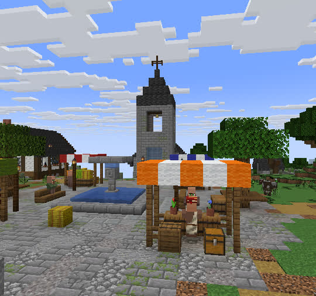 |
| 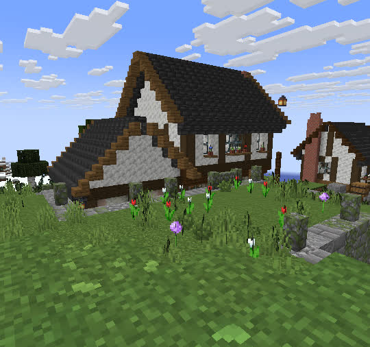 | 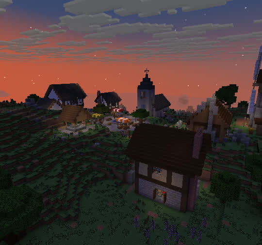 |
| 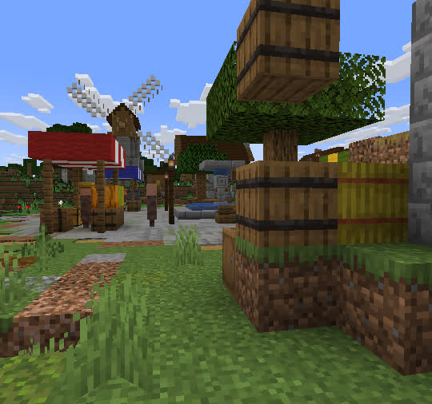 | |

Before and after (round 1's stepped pyramids and floating watchtower, round 2's fit):

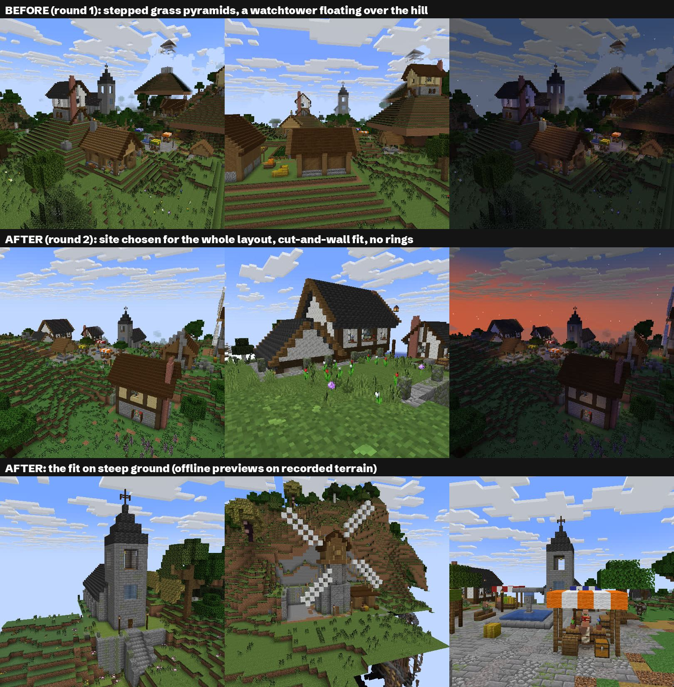

Compared with the old look (story_sheep_stares, `clearSet`'s flat clearing and a 6x6 `house`):

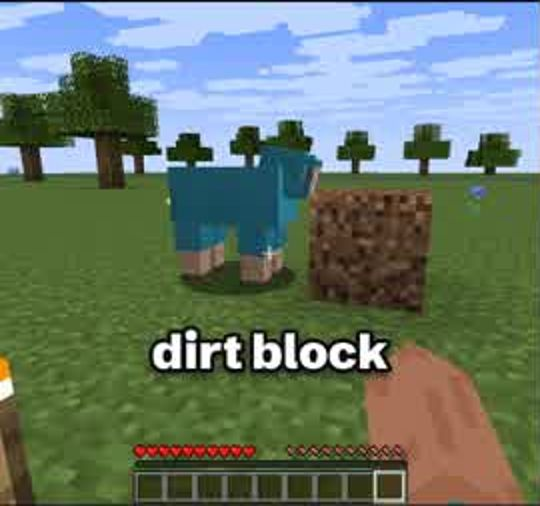

## Tools
| command | what |
|---|---|
| `node scripts/set_preview.js <piece> [--variant '{...}'] [--shots wide,front,low,<anchor>] [--base rec.json --x X --z Z] [--fit 0] [--out dir --tag name]` | preview a piece with no server: stamps it into a flat world, or into a recording's terrain with place()'s terrain fit (walls, steps, banks), and renders its shots to `work/set_preview/` (fence/pane shapes approximated; block states not turned for `--facing`) |
| `RECORD_ONLY=1 STUNT=_sets_catalog ./run.sh` then `node scripts/set_stills.js _sets_catalog docs/sets` | every piece on natural terrain, one still per piece (`PIECES=a,b` limits it; `FRESH=x,z` goes to new land first; `SLOPE=1` puts pieces on moderate slopes to show the fit; the dock goes on a shore) |
| `RECORD_ONLY=1 STUNT=_sets_demo ./run.sh` then `node scripts/set_stills.js _sets_demo docs/sets/demo` | the demo village and its five stills (`FRESH=x,z`, `DEMO_AT=x,z`, `VILLAGE=1`) |
| `STUNT=_sets_view AT=x,z node bot.js` (server running) | re-record a set already built in the world for fixed-camera stills (`CAM=dx,dy,dz,yaw,pitch node render.js ...`), optionally re-grading boxes (`REGRADE`) |
| `node scripts/bake_sets.js` | bakes every default piece to `assets/sets/<name>.nbt` (our own builds; load in any 1.21.11 world with `/place template` after copying to `world/generated/hellobuh/structures/`, or ship in a datapack under `data/hellobuh/structure/`) |

## Add a piece
`lib/sets/pieces/<name>.js` exporting `{ name, about, variants, build(v) -> Voxels }`, registered in
`pieces/index.js`. The Voxels kit (`lib/sets/voxel.js`): `fill` (modes hollow, outline, walls, keep, {replace}),
`set`, `mix` (weighted texture), `framed` (posts on the outer line, set-back panels, plinth, beam course), `sill`
(recessed window), `roof` (stair gable with eaves and brackets), `verge` (contrasting trim), `hipRoof`, `window`
(shutters, flower shelf), `door`, `bed`, `tall`, `hang` (lantern on chain), `post`, `sign`, `table`, `chair`,
`anchor`, `extra` (a live summon). Then `node scripts/set_preview.js <name>`, score it with the building guide's
checklist, and bake.
