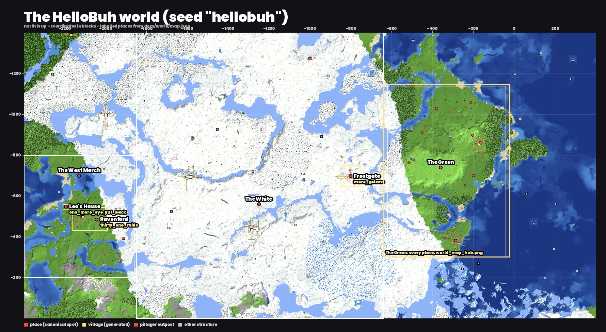
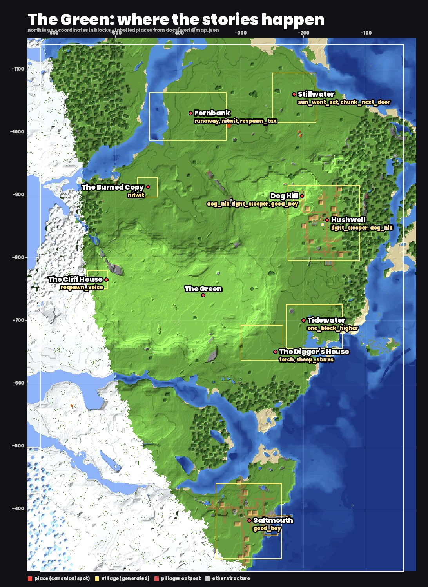
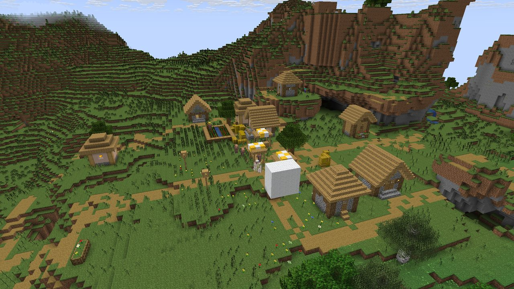
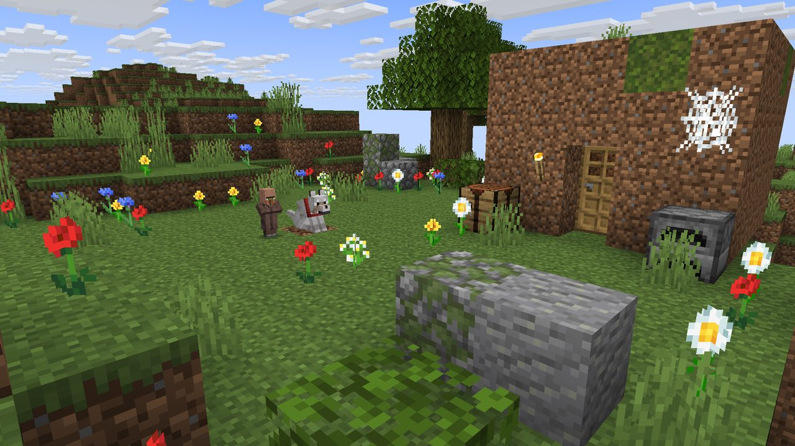
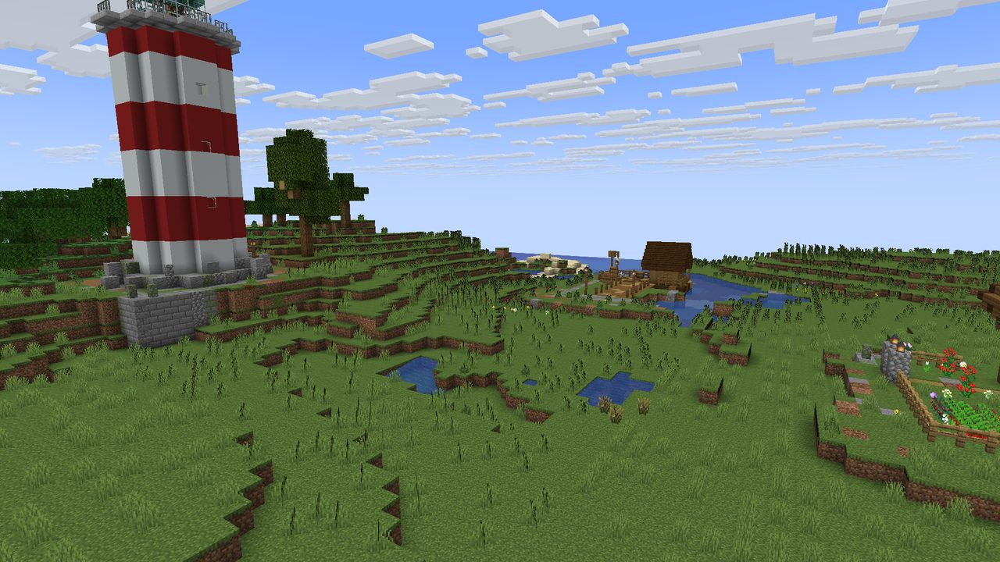

# The HelloBuh world: canon

Owner, 2026-11-10: **"wouldnt the lore be crazy if all of the sets were the same world"**.

Every HelloBuh story happens in one persistent Minecraft world. The same places, characters and consequences turn
up across Shorts, so the lore builds up for the viewers who watch them all. **Every Short still stands alone:** a
viewer who has seen nothing else gets the whole story. The links are things a fan notices in the background. The
plot never depends on them.

| file | what |
|---|---|
| `docs/world/canon.md` | this page: places, timeline, characters, the links between stories, conflicts, easter eggs |
| `docs/world/map.json` | every place's canonical coordinates, footprint, set pieces and stamps (with the days they exist), each story's place and day, the cameos |
| `docs/world/survey.json` | what the seed generates over the map (biomes, villages, outposts, the stronghold...), from `scripts/world_survey.py` |
| `lib/world.js` | `world.build(ctx, { story })` builds a story's places at their canonical spots as of its day |
| `scripts/world.js` (`./hb world`) | `check`, `list`, `where X Z`, `story S`, `claim ...`, `map`, `stunt S` |
| `out/world/world_map.png`, `world_map_hub.png` | the maps (not committed: `node scripts/world.js map`) |

## The rules
1. **Stands alone.** No line, clue or twist needs another Short. A name the viewer hasn't met isn't said. The
   story-critic's cold reader, who has seen nothing else, has to get it.
2. **One world, one spot per place.** A place's coordinates are in `map.json` and never move. A story builds there
   with `world.build`. No site searches, no clearings, no `/locate`: `lib/sets` refuses `planSite`/`findSite`/`findShore`
   once a stunt is in the shared world, and `node scripts/world.js stunt <stunt>` flags the rest.
3. **Published facts are fixed.** What a published Short shows or says is canon. A new story never contradicts it,
   and an old Short is never re-rendered to fit the canon. When two Shorts disagree, this page records how the
   disagreement is read (see "Conflicts"). A rendered Short that hasn't gone public yet counts as published.
4. **Consequences stick.** A story that changes a place (a grave, a building, someone gone, a hole in the ground)
   writes it here and in `map.json` as a stamp with `since: <day>`, in the same commit as its script. Every later
   story set there shows it.
5. **One easter egg per story** (see "Easter eggs"): in the background, true on the story's day, never spoken.
6. **Leave the big questions open.** Some things are never explained (see "Open questions"). Fans like a theory
   more than an answer.

## The world
- **Seed `hellobuh`** (Java 1.21.11, `server.properties`), spawn (128, 70, 16). It was already the seed of every
  story, so Dog on the Hill, Light Sleeper, Thirty-One Raids and Good Boy are in canon at the spots they were built.
  The survey (`stunts/_world_survey.js` + `scripts/world_survey.py`, 2,800 x 1,400 blocks, 15,400 chunks) shows enough
  variety for every kind of story:
  - **the Green**: a green island between the snow and the sea. It has plains, a forest rim, the High Meadow plateau
    (y 115-123), the North Inlet, a surface lava pool, sandy coves, and two plains villages (Hushwell, Saltmouth).
  - **the White**: 2 km of snowy plains, ice spikes and frozen rivers. It holds four snowy villages, igloos, trail
    ruins, two ancient cities deep under it, and a pillager outpost.
  - **the West March**: green coast beyond the White, with Ravenford (a plains village), a real pillager outpost,
    trial chambers, and the world's only stronghold in range, under the islets.
  - cold and deep oceans to the east, with two ocean monuments, shipwrecks and ruins.
- **Coordinates**: block coordinates, +x east, +z south. The sea surface is y 62. Every place has an `at` (its
  origin: the spot its story measures from) and a `footprint` (x0, z0, x1, z1).
- **Days**: the timeline counts in-game days from the world's first (day 0). Each story has a day in `map.json`
  `stories` (its last scene, or `span` for a long one). Pieces and stamps have `since`/`until` days.





`node scripts/world.js map` redraws both (full size in `out/world/`). Establishing stills from a `_world_build`
recording on day 4300: Hushwell with the boxed bell and Dog Hill above it, the dog and Pip by Buh's hut, and the
coast at Tidewater.

  

## Places

| place | where (at) | what's there | stories (day) |
|---|---|---|---|
| **Hushwell** | (-162, 79, -860): the well; generated plains village at (-170, -852) | Buh's home village on a terrace above the east coast. The vanilla houses, the well over the shrieker, and the bell boxed in white wool (from day 1400, for good). Carpeted from day 1400 until Buh stopped playing (day 3400). | Light Sleeper (1500), Dog on the Hill (4300) |
| **Dog Hill** | (-202, 108, -898): the dog's block, D | The hilltop north-west of Hushwell, 29 blocks above the plaza, as Dog on the Hill built it (the render is canon; its bible's sketch differs). A meadow levelled round D with a ridge to the west, Buh's 5x5 dirt hut north-east of D (D + (3..7, -8..-4), door south), the patch where he logged out (D + (3, 0, 0)), the dog on D facing it, and a pile of 14 bones. | Dog on the Hill (4300); the carpet street climbs toward it in Light Sleeper |
| **Fernbank** | (-380, 64, -1030): the well | Riverside village on the east bank of the North Inlet, 60 blocks west of the Lava Field. Cottages, the librarian's town house, a church, the churchyard, and a dock with the fisherman's boat. Empty except for the librarian and the iron golem from day 520. | Runaway (400), Nitwit (470), Respawn Tax (520) |
| **The Burned Copy** | (-448, 66, -912) | Past the last torch on Fernbank's south road: a burned, empty copy of a Fernbank house and well (the nitwit's world, which already ended) | Nitwit (470) |
| **The Digger's House** | (-245, 67, -650) | Birch cottage on the lowland under the High Meadow's east slope. Behind it is **Torch Hill**: a torch at (-290, -684) over a one-wide shaft 40 deep, with a torch every 4 blocks on the left wall. The blue sheep's dirt block (-268, -664), with a line of torches from the door, is an open hole from day 1112. | Torch (300), Sheep Stares (1112) |
| **Stillwater** | (-215, 68, -1060) | Small farming village on the north shore: Grandpa's cottage, the lever house, the neighbour's cottage, Gary's cottage and field, the one tree (-188, -1058), and the Long Day lever on a stone post (-214, -1062) | The Sun Won't Set (800-1100), The Chunk Next Door (1800) |
| **The Cliff House** | (-514, 121, -765) | Family house on the west rim of the High Meadow, above a 40-block fall to the White's frozen shore | Respawn Voice (1300) |
| **Tidewater** | (-200, 63, -700) | Lowland fishing hamlet one block above the sea, south of Hushwell; the lighthouse on the rise at (-150, -712), a dock | One Block Higher (2600, in progress) |
| **Saltmouth** | (-286, 69, -381): generated plains village | The south peninsula's village, a ruined portal on its east edge. Good Boy's yard is village + (37, 16). Buh lived here with the dog at 16. | Good Boy (3300, held) |
| **Frostgate** | (-801, 104, -697): generated snowy village | At the White's east edge, on the old road west | More Golems (2900, in progress) |
| **Ravenford** | (-2044, 71, -485): the east gate; generated plains village at (-2111, -497) | Grandpa's village across the White: the log palisade and east gate, Grandpa's house with the totem wall, the road over the ford to the Ridge and the old tower (-2000, -445). A real pillager outpost stands at (-1913, -393). | Thirty-One Raids (1900) |
| **Oakend** | (-505, 63, -1054): the west gate | A cleric's hamlet on the North Inlet's west bank, facing Fernbank across the water: a lane of cottages east of an oak fence and its west gate, a meadow climbing west to a dark oak treeline (lamp post at gate + (-15, 2)). Every villager wears a name tag. Tomas, Greta and Old Ben's cottages stand shut since a siege (~2500). | Names in the Woods (2700) |
| **Leo's House** | (-2195, 63, -548) | Stone cottage on the shore facing the islets over the stronghold. Its basement holds an end portal frame. | One More Eye (3000, in progress), Put Back (pilot) |
| **The Portal Cottage** | (-128, 85, -940): the cottage | A spruce cottage on the hill's south-east slope north of Hushwell, its garden looking down to the plaza (the boxed bell in view). The cellar, sunk under it on a ladder shaft, has a lit Nether portal in its east wall, a barrel of 25 years of barters ("Grandpa's Gifts") and obsidian patching the walls. Nico and his grandma live here (not Buh's family). | Gold for the Portal (9300) |

Regions: **the Green** (-620..-40, -1140..-300), **the White** (-1850..-640), **the West March** (-2400..-1860).
Empty land is there to be claimed: the High Meadow's top, the north forest, the coves east of Hushwell, the
White's villages (-1998, -994), (-1585, -692), (-1284, -435), the West March's south lakes, the ocean monuments
(95, -465) and (287, -1265).

## Timeline

| day | where | what happens (and who tells it) |
|---|---|---|
| 0 | | The world is made. |
| ~175 | The Portal Cottage | Nico's grandpa walks into the cellar's Nether portal in Grandma's gold helmet with the blue (lapis) stripe and never comes back. A piglin wears the helmet from then on. Grandma throws in one gold ingot a night (not in the Long Day); a barter comes back each morning. |
| 300 | Digger's House | **Torch.** A boy finds 40 of his own torches down a shaft on Torch Hill, digs straight down and dies in lava. He forgets every death. |
| 400 | Fernbank | **Runaway.** The creeper who thinks he's a boy goes to the village party. The fisherman jumps in his boat and never comes back. Only the nitwit stays near him. |
| 470 | Fernbank | **Nitwit.** The nitwit (4,096 hmms) leads the narrator past the last torch to the Burned Copy, and says his name and the date of the end: today. |
| 520 | Fernbank | **Respawn Tax.** Every respawn costs a villager. The fisherman's boat is found floating empty. The nitwit volunteers. In the end only the librarian is left. From here on Fernbank is empty but for her and the golem. |
| 700 | Digger's House | The Digger (memoryless again) digs under a dirt block, dies to a zombie that keeps his sword, and wakes with nothing. His blue sheep starts staring at the block. |
| 800-1100 | everywhere | **The Long Day.** A lever in Stillwater holds the sun up for 300 days. Time is global, so **no story may show a night in days 800-1100.** |
| 1100 | Stillwater | **The Sun Won't Set.** The lever goes back, the sun sets, and the zombies from under the one tree come out. The narrator is slain. Gary the farmer is taken that night. |
| 1112 | Digger's House | **Sheep Stares.** 412 days on, the Digger breaks the block, falls and dies to the same zombie. The hole stays open. |
| 1300 | Cliff House | **Respawn Voice.** A first death, two voices. The Short leaves the question open (the intended answer is in the stunt file). |
| 1300-1400 | Hushwell | Kid Buh builds his dirt hut on the hilltop. Hushwell finds the shrieker under its well and carpets everything, boxes the bell and lids the well (day 1400). |
| 1500 | Hushwell | **Light Sleeper.** Buh (about 10) plays a music disc on the open well and the warden rises. "Buh was obliterated by a sonically-charged shriek." His dog sits by its doghouse on the north slope. |
| ~1550 | | After the warden night Buh is sent across the White to Grandpa in Ravenford. |
| 1800 | Stillwater | **The Chunk Next Door.** 700 nights after the Long Day ended, the neighbour looks Gary in the face. |
| 1900 | Ravenford | **Thirty-One Raids.** Buh (about 11) drinks Grandpa's "courage". Raid 32. The 32nd frame on the totem wall is filled after it. |
| ~2000 | Leo's House | Put Back (pilot, not canon until made): Leo's house, blown up three years before, comes back block by block. |
| 2600 | Tidewater | One Block Higher (in progress). |
| ~2500 | Oakend | A zombie siege converts Tomas, Greta and Old Ben; they keep their name tags and walk out of the woods every night. Their cleric, Rosa, takes them a golden apple and a splash potion every week and can't use either. |
| 2700 | Oakend | **Names in the Woods.** Every night three named zombies walk out of the woods. Tonight a fourth wears Mom's tag, ROSA, still holding the apple, and her son Remy, the hamlet's only player, throws the cure: potion, then apple. Whether he cures the other three is never said. |
| 2900 | Frostgate | More Golems (in progress). |
| 3000 | Leo's House | One More Eye (in progress): eleven eyes; Leo left six years ago (day ~810). |
| 3300 | Saltmouth | **Good Boy** (held for rework). Buh at 16 and his dog, who keeps trying to leave him and keeps teleporting back. |
| 3400 | Dog Hill | Buh's last login: "Sit, boy. I'll be right back." The dog sits on the hilltop. Hushwell takes its carpets up (the shrieker only answers players). The bell stays boxed. |
| 4300 | Dog Hill | **Dog on the Hill.** 900 days. Pip sits with the dog every night. "Buh joined the game." "Hey, BUDDY! Sorry. Got busy." He leaves again. "Day ONE. AGAIN." **This is the present.** From here on, Pip and the dog sit on the hill together at night. |
| 9300 | The Portal Cottage | **Gold for the Portal.** Nico throws in a whole stack to buy his grandpa's way home. The piglin in Grandpa's helmet steps out, shaking, and Grandma sends it home with one more ingot. |

## Recurring characters

| who | look | voice (voices/cast.json) | canon |
|---|---|---|---|
| **Buh** | default Steve skin; the bot name and death screens say Buh (owner, 2026-11-10) | `milo` (Achird, 16) for Buh himself. As a kid (about 10-11) he narrates in the house narrator voice (`narrator`, Leda). | Grew up in Hushwell with Mom (Light Sleeper), spent a year or more with Grandpa in Ravenford (Thirty-One Raids), lived in Saltmouth with his dog at 16 (Good Boy), stopped playing on day 3400, came back for a minute on day 4300 (Dog on the Hill). He's a player: he respawns and he logs out. |
| **The dog** | pale wolf, tame, **red collar (CollarColor 14)**, Buh's | barks only | Buh's dog since his Hushwell childhood. Doghouse on Hushwell's north slope (Light Sleeper). Tries to leave Buh 37 times and teleports back every time (Good Boy, after its rework). Has sat on Dog Hill's D since day 3400, facing the patch where Buh logged out. Never stands up for anyone else. |
| **Pip** | baby plains villager, no profession | `narrator` (Leda) | Hushwell kid, about nine at day 4300. Brings the dog a bone every morning. Sits with him every night from Dog on the Hill on. Doesn't know who built the hut. |
| **Mom** | plains villager, farmer (straw hat) | `mom` (Sulafat) | Buh's mom in Hushwell. "Walk soft, Buh. The ground's a light sleeper." |
| **Grandpa (Ravenford)** | player actor, `zuri` skin; the slow walk | `elder` (Charon) | Buh's grandpa. Saved Ravenford from 31 raids that he brought himself with ominous bottles. Grandma died. Since raid 32 he and Buh fight together. |
| **Grandpa (Hushwell)** | plains villager, cartographer (monocle) | Algenib (Dog on the Hill) | Hushwell's elder. He knows whose dog it is ("Only one voice gets him up", "Said he'd be right back"). |
| **Grandpa (Stillwater)** | as in The Sun Won't Set | Kokoro (that Short) | Asked every day of the Long Day whether tonight was the night. "Already gone" when the sun set on day 1100. Never shown alive after it. |
| **The nitwit** | plains nitwit (green coat) | "hmm" | Fernbank's. He stands where something bad is about to happen: near the creeper (Runaway), in the wheat before a creeper, by the well, on a roof (Nitwit), on the respawn point (Respawn Tax). Gone from day 520. |
| **The iron golem** | iron golem | | Fernbank's. Follows the creeper everywhere (Runaway). Goes around the nitwit (Nitwit). Stands on the respawn point and keeps the line (Respawn Tax). Still by the well. |
| **The librarian** | plains villager, librarian | | Fernbank's. Raised the respawner and gave him bread "just in case". The last villager in Fernbank. |
| **The fisherman** | | | Fernbank's. Jumped in his boat and never came back. His boat floats empty at the dock. |
| **Gary** | zombie villager, farmer's straw hat, name tag "Gary" | | Stillwater's farmer. Taken the night the Long Day ended. Every night since, he walks out of the fog, works his field, pays an emerald, and knocks on his own door. The golem lets him pass. |
| **The Digger** | Steve-like; his death screens say HelloBuh | | Digs straight down under Torch Hill, dies, forgets, and starts again. "Never dig straight down." "Who digs straight down?" |
| **Remy** | default Steve skin, a kid; player nameplate "Remy" | `narrator` (Leda, Pip's voice) | Oakend's only player (not Milo's family). Wins every egg fight because nobody else there can throw. Cures his mom on day 2700. Never in a Short with Pip or kid Milo narrating (conflict 12). |
| **Rosa** | plains cleric villager (purple robe), name tag ROSA; on day 2700 a zombie villager in the same robe, still holding the golden apple | Aoede (her own, not the cast `mom`) | Remy's mom, Oakend's cleric. Told him the named zombies stole the tags and the neighbours moved to the city, to keep him out of the woods. |
| **Leo** | never seen | | The brother who went to the End with a wooden sword six years before One More Eye (in progress) and Put Back (pilot). |

## The links between stories
Each link has a status. **On screen** means both Shorts already show it. **Plant** means it needs a small change in
an unpublished story. **Theory** means fans can argue it and the canon never confirms it. None of them is needed to
follow any Short.

1. **The fisherman's empty boat** (on screen). In Runaway the fisherman "jumps in his BOAT and never comes back". In
   Respawn Tax, at the first respawn, "the FISHERMAN was gone. His boat just FLOATING there." It's the same village,
   Fernbank, and both Shorts are public. Two narrators each think the empty boat is about them. The boat is canon;
   why it's empty is not.
2. **One nitwit, one rule** (on screen). Nitwit's rule is that he always stands where something bad is about to
   happen. In Runaway, "Only the NITWIT stays" near the creeper. In Respawn Tax he walks up to the spawn point and
   volunteers. The rule explains both scenes after the fact.
3. **The Fernbank golem** (on screen). The same golem follows the creeper everywhere (Runaway), goes around the
   nitwit (Nitwit), and keeps the respawn line (Respawn Tax).
4. **Never dig straight down** (on screen). Torch ends "NEVER dig straight DOWN" over a fall into lava. Sheep Stares
   ends "Who digs STRAIGHT DOWN?" over a fall into a shaft. Both narrators forget their deaths (Torch: every death,
   the torches are his; Sheep Stares: no memories, a house already built, "the new one"). Both are the Digger at the
   same house under Torch Hill. Torch's dog that whines at the top and Sheep's sheep that stares at the block are
   the animals that remember.
5. **The night the sun set** (plant, no change needed). The Long Day ends on day 1100 with the zombies from under the
   one tree coming out. The Chunk Next Door's Gary has been "gone for 700 NIGHTS". Set both in Stillwater with The
   Chunk Next Door on day 1800, and Gary was taken the night the Long Day ended. Neither Short contradicts it, and a
   rewatch of The Sun Won't Set's zombie crowd gains a farmer.
6. **Hushwell is both villages** (on screen in coordinates; plant for viewers). Light Sleeper and Dog on the Hill
   were both built on the generated village at (-170, -852) and its north-west hill. Light Sleeper's carpet street
   climbs to the doghouse and the red-collared dog. Dog on the Hill is the same hill 2,800 days later. Plant: in
   Light Sleeper's S02, put the doghouse on the hilltop beside Buh's hut (around D + (0, 0, -6)) instead of 25 blocks
   downhill, so the crane ends on the exact spot where Dog on the Hill's dog will wait.
7. **The dog who tried to leave** (plant: Good Boy's rework). Good Boy's narrator is a tamed wolf with a red collar
   who has tried to leave "this guy" 37 times. Dog on the Hill's dog won't leave the hill for 900 days, waiting for
   Buh. Make them the same dog: in the rework the man is **Buh at 16** (he's already the Steve skin; recast his voice
   from Algenib to `milo`, Achird, the voice of Dog on the Hill's Buh). Both Shorts already have him say **"buddy"**
   ("There you ARE, buddy!", "Hey, BUDDY!"), and Good Boy's "GOOD BOY!" fits Dog on the Hill's "SIT, boy."
   The dog who wanted to get away ends up waiting 900 days. Good Boy stays a comedy that stands alone.
8. **Buh's childhood** (plant, no change needed). Light Sleeper (Hushwell, day 1500) and Thirty-One Raids
   (Ravenford, day 1900) are kid Buh two years apart, on opposite sides of the White. After he woke the warden,
   he was sent to Grandpa's. Dog on the Hill's Buh is him at 18, back for a minute.
9. **The HelloBuh graves** (theory). The early Shorts' death screens all say HelloBuh: Runaway "HelloBuh was blown up
   by Creeper", Sheep Stares "slain by Zombie using [HelloBuh's Sword]", The Sun Won't Set "slain by Zombie",
   Respawn Tax, Torch and Respawn Voice. Fernbank's churchyard has a row of headstones that all say HELLOBUH. Same
   player, or every nameless player? Never answered.
10. **Leo in the End** (plant, both unpublished). One More Eye's brother Leo went to the End six years ago. Put
    Back's big brother went to the End and never came back. Make them one brother at Leo's House (One More Eye's
    basement portal; Put Back's house coming back block by block). The world's only stronghold in range is under the
    islets in front of the house.

## Conflicts and how they're read (no published Short is re-rendered)

| # | conflict | resolution |
|---|---|---|
| 1 | Light Sleeper's Buh is a Hushwell kid, but in Dog on the Hill (rendered) Pip says "Nobody knows who built" the hut and "nobody in the village OWNS him" | Timeline: kid Buh (1500) stopped playing at 3400. Pip (about 9 at 4300) was small then. Grandpa knows ("only ONE voice"). Pip's lines are a kid's: true for him. No change. |
| 2 | Light Sleeper carpets all of Hushwell; Dog on the Hill shows a bare village | Light Sleeper's own vanilla rule: a natural shrieker answers only vibrations a **player** makes. The carpets were for Buh, Hushwell's only player, and came up when he left (day 3400). The bell stayed boxed. |
| 3 | Light Sleeper rebuilds Hushwell's plaza (8 cottages); Dog on the Hill's background shows the generated houses | Dog on the Hill was rendered first: the canonical Hushwell is the **generated village** plus the well and boxed bell. Light Sleeper's builder: keep the vanilla houses that ring the plaza where you can (the plaza floor, the well and the bell are what the story needs). In Dog on the Hill the plaza is far in the background. |
| 4 | Light Sleeper's dog and doghouse sit 25 blocks downhill from Dog on the Hill's D | Plant 6: move the doghouse to the hilltop (one shot, unpublished). If it isn't moved, it's the dog's daytime spot while Buh still lived there. |
| 5 | Kid Buh has two home villages: "My village" (Hushwell, with Mom) and "our village" (Ravenford, with Grandpa) | Sent to Grandpa after the warden night (~1550). By day 1900 Ravenford is "our village". Neither Short says otherwise. How Mom (a villager) and Grandpa (a human) are related is never said (open question). |
| 6 | Good Boy's man is "a cheerful old farmer" (Algenib), and the dog in Dog on the Hill is Buh's | Good Boy is held for a rework anyway: the man becomes Buh at 16 (plant 7). If it ships unchanged, its dog is another red-collared wolf (red is vanilla's default collar) and the link is dropped. |
| 7 | The early Shorts' death screens say HelloBuh; the hero is Buh from 2026-11-10 | The early narrators are not Buh: the creeper, the respawner, the Digger, the Stillwater grandson, the Cliff House kid. HelloBuh is the name on their death screens, and in canon that's an open mystery (link 9). From now on, death screens say Buh or a character's own name. |
| 8 | Runaway and Respawn Tax explain the fisherman's disappearance differently | Both are kept as two unreliable narrators' readings (link 1). |
| 9 | Nitwit says "the date of the END: it's TODAY", but the nitwit is still there in Respawn Tax | Order: Nitwit (470), then Respawn Tax (520). "The end" is the end of Fernbank, emptied by the respawn tax within 50 days. The nitwit volunteers because he knew. |
| 10 | The Sun Won't Set freezes the sun, and time is global | The Long Day (800-1100) is a world event. No story shows a night in it. Checked: every story day is outside it. Sheep Stares' 412 days overlap it, but its night shots fall after day 1100. |
| 11 | Three different grandpas | Three people with three looks and voices (characters table). Rule: one grandpa per Short, called "Grandpa" only by his own grandchild. |
| 12 | Voices: Pip and kid Buh both use Leda; Hushwell's grandpa (Algenib) shares the cast's `stranger` voice | Never have Pip and kid Buh narrate in the same Short. Hushwell's grandpa keeps Algenib (he's on screen), so cast the stranger with a different voice before his first story. |
| 13 | Light Sleeper's ancient city under Hushwell isn't generated (the seed's are 1,200 blocks west, under the White) | It's built by the story: a buried shrieker under the well. Canon: "something old under Hushwell's well". |
| 14 | Thirty-One Raids builds its own palisade, gate, Grandpa's house and totem wall in its stunt (gate-relative) | Canon at those coordinates (map.json `ravenford.story_builds`). Move them into map.json pieces and stamps when the next Ravenford story needs them. |
| 15 | Dog on the Hill's bible puts the hut west of D with the patch at D + (-3, 0, 0); its stunt (and render) builds the hut north-east of D, the patch at D + (3, 0, 0), the dog facing east | The render is canon. map.json's Dog Hill stamps are the stunt's own build, ported (meadow, ridge, hut, ledge, patch, bones, dog). |
| 16 | The recorder on main doesn't save a wolf's sitting/tame/collar state (claude/story-cine-2's harness does), so a main recording shows the dog standing with no collar | The establishing still patches the recording's wolf entries. Merge story-cine-2's harness wolf metadata to main before any story films the dog. |
| 17 | The Sign by the Bed and Same Spot (pilots, never made) set other "world rules" (signs from the future, frozen chunks) | Not canon. A pilot becomes canon only when it's made, and then it has to fit. |

## Easter eggs
**Rules:** one per story; in the background (out of focus, off centre, never the subject of a shot); on screen 1-3 s;
never named in a line or a caption; never needed to follow the story; true on the story's day (`since`/`until` in
`map.json` `cameos`); listed in the story's `map.json` entry (`cameos`) so `world.build` builds it, and in the
bible's Props table with its shot. **Geography is the biggest one:** the skyline has to match. The hill north-west
of Hushwell, the lighthouse south of it, the Ridge's tower east of Ravenford.

| cameo | where it can be seen | days |
|---|---|---|
| `dog_on_hill`: a pale wolf with a red collar sitting on the hilltop | Hushwell, the north road, Stillwater's south fields, Tidewater's beach (a speck on the skyline) | 3400 on |
| `pip_and_dog`: the dog and a baby villager side by side on the hilltop at night | Hushwell at night | 4300 on |
| `boxed_bell`: Hushwell's bell boxed in white wool | Hushwell's plaza | 1400 on |
| `empty_boat`: an empty oak boat at the end of Fernbank's dock | the North Inlet | 400 on |
| `hellobuh_graves`: headstones that all say HELLOBUH | Fernbank's churchyard | 520 on |
| `fernbank_golem`: an iron golem in an empty village | Fernbank | 520 on |
| `torch_hill`: a lone torch on the slope under the High Meadow | the Digger's House, Tidewater | 300 on |
| `blue_sheep`: a blue sheep staring at one dirt block | the Digger's House | 700-1112 |
| `long_day_lever`: a lever on a stone post | Stillwater's square | always (pulled back from 1100) |
| `gary`: a zombie villager in a straw hat at the fog line, name tag Gary | Stillwater at night | 1100 on |
| `burned_copy`: a burned copy of a Fernbank house | south of Fernbank's last torch | always |
| `raven_tower`: the old watchtower on the Ridge, no banner | Ravenford | always |
| `totem_wall`: 31 totems and one empty frame (all 32 full after day 1900) | Grandpa's house in Ravenford | always |

## How a story uses the world
1. **Pitch** (`/story-write`): name the place (from `node scripts/world.js list`, or a new one in empty land) and
   the day. Check this page for that place and day: who lives there, what's already happened, the Long Day.
2. **Claim** a new place before building, in its own commit, like a premise claim:
   `node scripts/world.js claim <key> --name "Name" --at x,y,z --footprint x0,z0,x1,z1 --story <name> --day N`.
   Read the ground y off `out/world/world_map_hub.png` and the survey grid (`scripts/world_survey.py` writes
   `~/.cache/hellobuh/world/survey/grid.npz`). Then add the place's `pieces` (set library piece, x, y, z, facing,
   variant) and `stamps` to `map.json`, and run `node scripts/world.js check`.
3. **Build** in the stunt's `setup`:
   ```js
   const world = require('../lib/world')
   const W = await world.build(ctx, { story: 'my_story' })   // its places + cameos as of its day, at their spots
   const O = W.places.fernbank.origin                        // { x, y, z }: stage everything from here
   const door = W.places.fernbank.pieces.librarian.anchors.door
   ```
   run.sh wipes the server's world every run. That's fine: the seed regenerates the same terrain and villages, and
   `world.build` puts our pieces and stamps back at the same coordinates. Story-only things (tonight's mess, the
   cast) go on top in the stunt. Anything that stays after the story goes into `map.json` with `since: <day>`.
   For speed, `WORLD_SAVE_SNAPSHOT=<name>` saves the built world to `~/.cache/hellobuh/world/snap/<name>` (outside
   git), and `WORLD_SNAPSHOT=<name> ./run.sh` starts from it (`world.build` skips what's already built). Never
   commit region files.
4. **Check**: `node scripts/world.js stunt story_<name>` (no site search, no clearing, no `/locate`), and the
   story-critic's and story-continuity's canon checks (`.claude/agents/`).
5. **Write back**: the story's `map.json` entry gets `status: "made"`, and this page gets its row in the timeline,
   any new character, and its consequences.

Tools: `RECORD_ONLY=1 STUNT=_world_survey ./run.sh` re-surveys (after a seed or area change), then
`python3 scripts/world_survey.py` and `node scripts/world.js map`. `RECORD_ONLY=1 WORLD_PLACES=a,b WORLD_DAY=N
WORLD_AT=x,z STUNT=_world_build ./run.sh` builds places and records them for stills (`scripts/still.py`).

## Open questions (never answered on screen)
- Why do the early tales' death screens all say HelloBuh?
- What's under Hushwell's well, and is it still awake?
- How are Mom (a Hushwell villager) and Grandpa (a Ravenford man) related?
- Whose world was the Burned Copy, and when does Fernbank burn?
- What came through One More Eye's portal?
- Will Buh come back to the hill?
